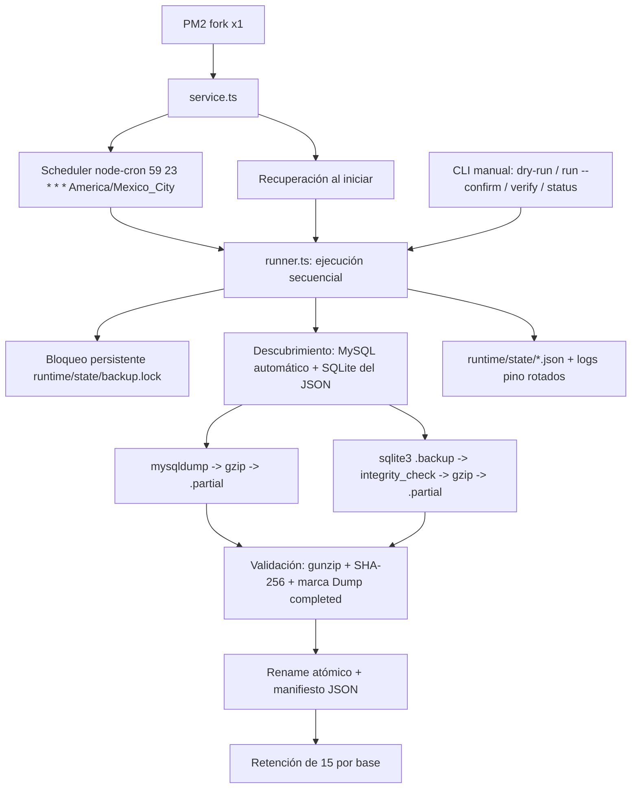

# mbc-backup-service

Servicio **único y centralizado** de respaldos automáticos para las bases de datos de los proyectos alojados en el servidor Windows: descubre automáticamente todos los esquemas de MySQL, respalda las bases SQLite registradas, conserva los **últimos 15 respaldos válidos de cada base** y funciona como **un solo proceso PM2** de muy bajo consumo.

- Sin puertos HTTP, sin API, sin base de datos adicional (estado en JSON con escritura atómica).
- Un solo repositorio y un solo proceso. No modifica las aplicaciones existentes ni las bases originales.
- Solo respaldos **diarios** (no existen carpetas semanales ni mensuales).

## Contenido

1. [Arquitectura](#arquitectura)
2. [Estructura del proyecto](#estructura-del-proyecto)
3. [Instalación local](#instalación-local)
4. [Configuración](#configuración) (variables de entorno, MySQL, SQLite)
5. [Seguridad](#seguridad)
6. [Programador y flujo de una ejecución](#programador-y-flujo-de-una-ejecución)
7. [Retención](#retención-de-respaldos)
8. [Recuperación ante fallos](#recuperación-ante-fallos)
9. [Comandos](#comandos-disponibles)
10. [PM2 y despliegue](#ejecución-con-pm2-y-despliegue)
11. [Agregar bases de datos](#agregar-nuevas-bases-de-datos)
12. [Verificar y restaurar](#verificar-los-respaldos)
13. [Limitaciones](#limitaciones-y-consideraciones-operativas)

## Arquitectura



Decisiones de diseño:

| Tema | Decisión |
|---|---|
| Secuencialidad | Una base a la vez; nunca hay dos `mysqldump`/`sqlite3` simultáneos. |
| Memoria | Todo por *streams* (`mysqldump` stdout → SHA-256 → gzip → archivo). Nunca se carga una base completa. |
| CPU | GZIP nivel 4 (configurable), procesos hijo y servicio con prioridad *Below Normal*. |
| Consistencia MySQL | `--single-transaction` (instantánea InnoDB sin bloquear escrituras). |
| Consistencia SQLite | Comando `.backup` de sqlite3 (maneja WAL/SHM). Nunca se copia el `.db` directamente. |
| Publicación | Todo se escribe como `.partial`; solo tras validar se renombra de forma atómica y se escribe el manifiesto. Un archivo sin manifiesto válido **no es un respaldo**. |
| Estado | JSON con escritura atómica (temporal + fsync + rename). |
| Aislamiento de fallos | Cada base se respalda en su propio `try/catch`; un fallo conserva los respaldos anteriores de esa base y continúa con las demás. |

### Opciones de `mysqldump` (compatibles con MySQL 8.0 y 8.4)

| Opción | Motivo |
|---|---|
| `--single-transaction` | Instantánea consistente InnoDB sin bloquear a las aplicaciones. |
| `--quick` | Lectura fila por fila; sin cargar tablas completas en memoria. |
| `--routines --events --triggers` | Objetos programables (según permisos de `mbc_backup`). |
| `--hex-blob` | Columnas binarias seguras. |
| `--no-tablespaces` | Evita requerir el privilegio `PROCESS`. |
| `--set-gtid-purged=OFF` | Volcado restaurable en cualquier servidor; no requiere `RELOAD`. |
| `--databases -- <esquema>` | Incluye `CREATE DATABASE`/`USE`; el `--` evita que un nombre se interprete como opción. |
| `--default-character-set=utf8mb4`, `--max-allowed-packet=64M` | Codificación correcta y filas grandes. |

No se usa `--all-databases` (cada esquema se exporta por separado). **Usar el `mysqldump` de la misma versión que el servidor (8.4)**; `npm run tools` avisa si no lo es.

## Estructura del proyecto

```
mbc-backup-service/
├── src/
│   ├── config/        schema.ts (zod), load.ts (env + databases.json + validaciones)
│   ├── discovery/     mysql.ts (esquemas + exclusiones), index.ts (inventario de objetivos)
│   ├── backup/
│   │   ├── mysql/dump.ts     mysqldump por streaming + archivo de opciones temporal
│   │   ├── sqlite/backup.ts  .backup + integrity_check + gzip
│   │   ├── gzip.ts           gzip/gunzip por streaming, SHA-256
│   │   ├── tools.ts          comprobación de herramientas
│   │   └── runner.ts         orquestación de la ejecución (los 15 pasos)
│   ├── scheduler/     node-cron + recuperación + apagado ordenado
│   ├── retention/     retención por base
│   ├── storage/       layout (rutas/manifiestos), lock, state, disk
│   ├── validation/    verificación de respaldos existentes
│   ├── recovery/      evaluación de RECOVERY, ejecuciones interrumpidas, temporales huérfanos
│   ├── logging/       pino + rotación
│   ├── util/          rutas seguras, escritura atómica, tiempo/zonas, procesos, errores
│   ├── cli/           comandos manuales
│   ├── service.ts     proceso permanente (PM2)
│   └── index.ts
├── config/
│   ├── databases.example.json       (versionado)
│   ├── databases.json               (por instalación; en .gitignore)
│   └── create-mbc-backup-user.sql   (script documentado; NO se ejecuta solo)
├── tests/             pruebas (node:test) con SQLite desechables y procesos simulados
├── docs/DEPLOYMENT-WINDOWS-SERVER.md
├── runtime/           (en .gitignore) logs/ state/ temp/
├── .env.example  ecosystem.config.cjs  package.json  tsconfig*.json
```

## Instalación local

Requisitos: Node.js **22.18+ (rama 22)** o **26 LTS**, npm. No hay dependencias nativas (nada se compila al instalar).

```powershell
git clone <url-del-repositorio> mbc-backup-service
cd mbc-backup-service
npm ci
npm run build
npm test
copy .env.example .env
copy config\databases.example.json config\databases.json
```

En **desarrollo** (`MBC_MODE=development`, valor por defecto) ninguna orden se conecta a MySQL ni escribe en `BACKUP_ROOT` salvo que se defina `MBC_ALLOW_LIVE=true` de forma explícita. `npm run dev` jamás inicia el programador ni abre conexiones.

## Configuración

### Variables de entorno (`.env`)

| Variable | Defecto | Descripción |
|---|---|---|
| `MBC_MODE` | `development` | `production` en el servidor (lo fija `ecosystem.config.cjs`). |
| `MBC_ALLOW_LIVE` | `false` | Solo en desarrollo: permite operaciones reales (conexiones/escrituras). |
| `ENABLE_SCHEDULER` | `false` | El programador solo corre si es `true` (lo fija PM2). |
| `BACKUP_ROOT` | *(obligatoria)* | `C:\Servidor\BasesDatos\Respaldos\Diarios`. |
| `SQLITE3_PATH` | `C:\Servidor\Herramientas\SQLite\sqlite3.exe` | |
| `MYSQLDUMP_PATH` | `mysqldump` | Ruta del `mysqldump` 8.4. |
| `CONFIG_PATH`, `RUNTIME_DIR` | `config/databases.json`, `runtime` | |
| `CRON_EXPRESSION`, `TIMEZONE` | `59 23 * * *`, `America/Mexico_City` | |
| `RETENTION_COUNT` | `15` | Respaldos válidos por base. |
| `MIN_FREE_GB` | `10` | Reserva mínima de espacio libre. |
| `GZIP_LEVEL` | `4` | 1–9 (bajo = menos CPU). |
| `RECOVERY_ENABLED`, `RECOVERY_DELAY_SECONDS` | `true`, `120` | Copia RECOVERY al iniciar si se perdió la diaria. |
| `SHUTDOWN_GRACE_SECONDS` | `90` | Tiempo para terminar la base en curso al apagar. |
| `TOOL_TIMEOUT_MINUTES` | `360` | Tiempo máximo por exportación. |
| `LOCK_STALE_MINUTES`, `TEMP_MAX_AGE_HOURS` | `10`, `1` | Detección de bloqueos/temporales abandonados. |
| `LOG_LEVEL`, `LOG_MAX_MB`, `LOG_MAX_FILES`, `LOG_TO_CONSOLE` | `info`, `10`, `10`, `false` | Rotación por tamaño. |
| `MYSQL_PRINCIPAL_PASSWORD` | – | Contraseña de `mbc_backup` (nombre configurable con `passwordEnv`). |

### MySQL (descubrimiento automático)

`config/databases.json`:

```json
{
  "mysql": [
    { "id": "principal", "host": "127.0.0.1", "port": 3306, "user": "mbc_backup",
      "passwordEnv": "MYSQL_PRINCIPAL_PASSWORD", "autoDiscover": true,
      "excludeSchemas": [], "namespaced": false }
  ],
  "sqlite": []
}
```

- Cada ejecución consulta `information_schema.SCHEMATA` y respalda **todos** los esquemas salvo `mysql`, `information_schema`, `performance_schema` y `sys` (siempre excluidos) y los de `excludeSchemas`. Una base nueva se respalda sin tocar la configuración.
- `autoDiscover: false` + `includeSchemas: [...]` permite una lista explícita.
- Otra instancia MySQL: añada otra entrada con su `id`, `host`, `port`, `user` y `passwordEnv`; póngale `"namespaced": true` (carpeta `mysql/<instancia>/<esquema>`). Solo una instancia puede usar el diseño plano `mysql/<esquema>`.
- Cuenta dedicada: ejecute **manualmente** [`config/create-mbc-backup-user.sql`](config/create-mbc-backup-user.sql) (privilegios de solo lectura: `SELECT, SHOW VIEW, TRIGGER, EVENT, SHOW_ROUTINE`).
- Las tablas no InnoDB (p. ej. MyISAM) no tienen instantánea consistente con `--single-transaction`; el servicio lo advierte en el log.

### SQLite (registro explícito)

```json
"sqlite": [
  { "id": "kpis", "name": "KPIs", "path": "C:\\Servidor\\BasesDatos\\SQLite\\KPIs\\kpi.db", "enabled": true }
]
```

Solo se respaldan los archivos registrados (nunca se escanea el disco). `id` único (letras, números, `_`, `-`); `path` absoluto. `databases.json` se **relee en cada ejecución**: agregar una base SQLite no requiere reiniciar el proceso.

## Seguridad

- **Credenciales**: la contraseña vive solo en `.env` del servidor (variable de entorno). Para `mysqldump` se escribe un archivo de opciones temporal (`runtime/temp/mysqldump-*.cnf`, modo 0600, creado con `wx`) que se sobrescribe y elimina al terminar. Nunca va en argumentos de línea de comandos, logs, manifiestos ni estado. Los errores de herramientas se redactan; pino enmascara campos `password/token/secret`.
- **Git**: `.gitignore` excluye `.env`, `config/databases.json`, `runtime/`, `logs/`, `temp/`, `.local-backups/`, `*.partial`, `*.cnf`, `*.sql.gz`, `*.sqlite.gz`, manifiestos y carpetas de respaldos.
- **Rutas**: los nombres de base se codifican a segmentos seguros (`[A-Za-z0-9_-]`, el resto `~HH`); toda ruta se verifica dentro de `BACKUP_ROOT`. La retención solo borra archivos con el formato propio, cuyo manifiesto pertenece a la misma base.
- **Permisos NTFS recomendados** (ejecutar como administrador, ajustando la cuenta con la que corre PM2, p. ej. `SVC_PM2`):

  ```powershell
  icacls "C:\Servidor\BasesDatos\Respaldos" /inheritance:r /grant:r "SYSTEM:(OI)(CI)F" "Administrators:(OI)(CI)F" "SVC_PM2:(OI)(CI)M"
  icacls "C:\Servidor\mbc-backup-service\.env" /inheritance:r /grant:r "SYSTEM:F" "Administrators:F" "SVC_PM2:R"
  icacls "C:\Servidor\mbc-backup-service\runtime" /inheritance:r /grant:r "SYSTEM:(OI)(CI)F" "Administrators:(OI)(CI)F" "SVC_PM2:(OI)(CI)M"
  ```
- **BitLocker** en el volumen de respaldos (contienen información productiva) y, a futuro, una **copia externa** (otro equipo/nube cifrada): un respaldo en el mismo disco no protege ante fallo del disco.

## Programador y flujo de una ejecución

`node-cron` con `59 23 * * *`, zona `America/Mexico_City`, `noOverlap: true`, más el bloqueo persistente entre procesos. Pasos de cada ejecución:

1. Adquirir bloqueo exclusivo (`runtime/state/backup.lock`, latido periódico).
2. Validar configuración (se relee `databases.json`).
3. Comprobar herramientas (`mysqldump --version`, `sqlite3 -version`).
4. Comprobar espacio libre (≥ `MIN_FREE_GB`); si no alcanza se **detiene sin borrar nada**.
5. Detectar esquemas MySQL.
6. Inventario SQLite.
7. Respaldar **secuencialmente**, una base a la vez, en `.partial`.
8. Comprimir (gzip por streaming).
9. Validar: `gunzip` completo (CRC), SHA-256 del contenido coincidente, `Dump completed` (MySQL) / `PRAGMA integrity_check = ok` (SQLite).
10. SHA-256 del archivo final.
11. Publicar (rename atómico) + manifiesto `.manifest.json`.
12. Actualizar registro de ejecución (`runtime/state/runs/run-*.json`) y estado.
13. Retención de 15 por base.
14. Liberar el bloqueo.
15. Registrar resultado (`success`, `partial`, `failed`, `aborted`, `interrupted`).

Estructura de salida:

```
C:\Servidor\BasesDatos\Respaldos\Diarios\
  mysql\calidad_mbc\2026\11\2026-11-24_235900.sql.gz
                                 2026-11-24_235900.sql.gz.manifest.json
  sqlite\kpis\2026\11\2026-11-24_235900.sqlite.gz
```

Copias de recuperación: `..._RECOVERY.sql.gz`; manuales: `..._MANUAL.sql.gz`. El manifiesto incluye id, motor, origen, inicio/fin, tipo de ejecución, archivo, tamaño, SHA-256, resultado de validación, versión de herramienta, duración y estado.

## Retención de respaldos

Se conservan los **últimos 15 respaldos válidos de cada base** (no “15 días”: son las últimas 15 copias válidas). Reglas:

- Solo se aplica **después** de publicar y validar el nuevo respaldo de esa base.
- Si una base falla, no se aplica retención a ella (se conservan todos sus respaldos anteriores) y se continúa con las demás.
- Cuenta únicamente respaldos válidos (manifiesto íntegro, pertenece a la base, archivo con el tamaño esperado).
- Solo elimina `archivo + manifiesto` de la propia base con nombres del formato del servicio. Nunca borra carpetas de año/mes ni archivos ajenos, y nunca hace limpiezas generales.
- Ejemplo: 24 respaldos de `calidad_mbc` → quedan los 15 más recientes y se eliminan los 9 más antiguos; las demás bases no se tocan.

## Recuperación ante fallos

| Escenario | Comportamiento |
|---|---|
| Reinicio de servidor/PM2 o caída | Al iniciar compara el último hueco programado (23:59) con el último fin de ejecución completada (`state.json`). Si se perdió, programa **una única** copia `RECOVERY` tras `RECOVERY_DELAY_SECONDS`. |
| Varios días perdidos | Una sola copia `RECOVERY`, no una por día. |
| Fecha de la copia RECOVERY | La hora **real** de generación (nunca simula una fecha pasada); no sobrescribe nada. |
| Ejecución interrumpida | La ejecución en curso se marca `interrupted`, no cuenta como completada y la siguiente evaluación puede disparar recuperación. |
| Bloqueo abandonado | Se reclama solo si el PID no existe o el latido caducó (`LOCK_STALE_MINUTES`); un proceso vivo con latido reciente nunca se desplaza. |
| `.partial`/`.cnf` huérfanos | Se eliminan (con el bloqueo adquirido) si superan `TEMP_MAX_AGE_HOURS` y tienen el patrón propio. |
| Primera instalación | No hay línea base: no se inventa una recuperación. |

Apagado ordenado (`SIGINT/SIGTERM/SIGBREAK` o mensaje `shutdown` de PM2 en Windows): detiene el programador, no inicia nuevas bases, deja terminar la base en curso hasta `SHUTDOWN_GRACE_SECONDS`; si no termina, la cancela (mata el hijo, borra `.partial` y credenciales temporales, libera bloqueo).

## Comandos disponibles

Compile primero (`npm run build`); los comandos usan `dist/`.

| Comando | Función |
|---|---|
| `npm run dev` | Inicia en desarrollo (`tsx`). Programador **desactivado**; no se conecta a nada. |
| `npm run build` | Compila TypeScript a `dist/`. |
| `npm run typecheck` | Verifica tipos (incluye pruebas). |
| `npm test` | Ejecuta la suite de pruebas. |
| `npm run validate-config` | Valida `.env` y `databases.json` (sin conexiones). |
| `npm run tools` | Comprueba `mysqldump` y `sqlite3`. |
| `npm run backup:dry-run` | Simula: detecta bases y muestra qué se respaldaría. No escribe respaldos. |
| `npm run backup:run -- --confirm` | Respaldo manual real. Sin `--confirm` no hace nada. |
| `npm run backup:verify [-- --deep --latest --db <id>]` | Verifica respaldos existentes. |
| `npm run health-check` | Estado: última ejecución, bloqueo, espacio libre. |

## Ejecución con PM2 y despliegue

Ver la guía completa: [docs/DEPLOYMENT-WINDOWS-SERVER.md](docs/DEPLOYMENT-WINDOWS-SERVER.md). Resumen: se agrega **solo** `mbc-backup-service` con `pm2 start ecosystem.config.cjs` (fork, 1 instancia, sin `max_memory_restart`, `kill_timeout` 150 s). **Nunca** use `pm2 restart all`, `pm2 delete all` ni `pm2 kill`.

## Agregar nuevas bases de datos

- **Nueva base MySQL en una instancia existente**: no hace nada; se detecta sola en la siguiente ejecución. (Si el esquema debe excluirse: añádalo a `excludeSchemas`.)
- **Nueva instancia MySQL**: nueva entrada en `mysql` (con `namespaced: true`) + variable de contraseña en `.env` + cuenta `mbc_backup` en esa instancia.
- **Nueva base SQLite**: nueva entrada en `sqlite` (`id`, `path`). Se toma en la siguiente ejecución sin reiniciar. Compruebe con `npm run backup:dry-run`.

## Verificar los respaldos

```powershell
npm run backup:verify -- --latest          # último respaldo de cada base
npm run backup:verify                      # todos
npm run backup:verify -- --deep --db kpis  # SQLite: descomprime y PRAGMA integrity_check
```

Comprueba tamaño, SHA-256 del archivo, CRC de gzip, SHA-256 del contenido y, en MySQL, que el volcado esté completo. Manualmente: `Get-FileHash <archivo>.gz -Algorithm SHA256` y compárelo con `sha256` del manifiesto.

## Restaurar

> Restaure primero en un servidor/esquema **de prueba**. Nunca restaure sobre producción sin respaldar el estado actual.

**MySQL** (el volcado incluye `CREATE DATABASE`/`USE`):

```powershell
# Descomprimir en streaming (PowerShell) y restaurar con una cuenta con permisos de escritura
$gz = "C:\Servidor\BasesDatos\Respaldos\Diarios\mysql\calidad_mbc\2026\11\2026-11-24_235900.sql.gz"
$sql = "C:\Temp\calidad_mbc.sql"
$in = [IO.File]::OpenRead($gz); $out = [IO.File]::Create($sql)
$gs = New-Object IO.Compression.GZipStream($in, [IO.Compression.CompressionMode]::Decompress)
$gs.CopyTo($out); $gs.Dispose(); $out.Dispose(); $in.Dispose()
mysql -u root -p --default-character-set=utf8mb4 -e "source C:/Temp/calidad_mbc.sql"
```

Para restaurar con otro nombre, cree el esquema de destino y edite/elimine las líneas `CREATE DATABASE`/`USE` del `.sql`.

**SQLite** (detenga antes la aplicación que usa la base):

```powershell
$gz = "...\sqlite\kpis\2026\11\2026-11-24_235900.sqlite.gz"
# descomprimir igual que arriba a C:\Temp\kpi_restaurado.db
& "C:\Servidor\Herramientas\SQLite\sqlite3.exe" C:\Temp\kpi_restaurado.db "PRAGMA integrity_check;"   # debe responder ok
# luego copie a la ruta definitiva con la aplicación detenida y elimine -wal/-shm antiguos
```

## Limitaciones y consideraciones operativas

- Los respaldos están en el **mismo servidor**: configure a futuro una copia externa.
- `--single-transaction` no da consistencia a tablas no InnoDB.
- Si el cuenta `mbc_backup` carece de `EVENT`/`SHOW_ROUTINE`/`TRIGGER`, `mysqldump` omite esos objetos sin error: verifique con `SHOW GRANTS`.
- Un `mysqldump` 8.0 contra un servidor 8.4 puede no ser compatible: use el cliente 8.4.
- El servicio ejecuta en horario `America/Mexico_City`; la ejecución diaria a las 23:59 usa la hora real de inicio en el nombre del archivo (puede ser 23:59:01…).
- Nombres de esquema que difieren solo por mayúsculas comparten carpeta en NTFS (insensible a mayúsculas); no es habitual en Windows (`lower_case_table_names=1`).
- Las pruebas locales simulan `sqlite3.exe`/`mysqldump` (ver informe); la integración real con los binarios se valida en el servidor con `npm run tools` y `npm run backup:dry-run`.
